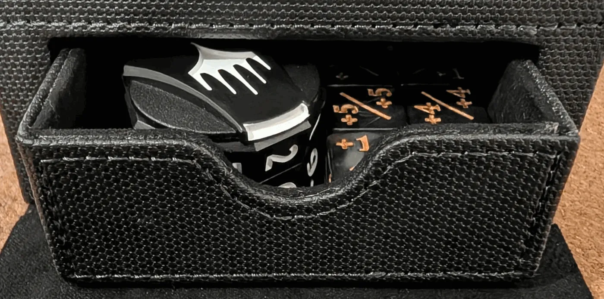

The [Gamegenic Sidekick Pro 100+ XL Convertible][sidekick] has a small tray
that slides out of the bottom of the box for dice, tokens and counters. Its
dimensions aren't published anywhere I could find, so I measured mine.

```schematic alt="Isometric view of a Gamegenic Sidekick Pro XL deck box with the tray pulled out of its cubby on the left face, dimensioned" src="schematics/sidekick-pro-xl.schematic.yaml" view="iso"
```

Dimensions are approximate (my calipers aren't the best):

- Tray (outside): `85.7 × 80 × 33.7 mm`
- Tray (inside): `75.1 × 69.4 × 28.4 mm`
- Tray cubby: `88.5 × 80 × 36 mm`

The cubby is 2.3 mm taller than the tray, and that headroom is usable, so the
usable space is about `75.1 × 69.4 × 30.7 mm`: enough for a WotC clickwheel life counter.



It's a good box for a draft kit. There's enough space for a clickwheel, some
dice, tokens, and pre-sleeved lands. And enough leftover space for a sleeved up
40 card deck.

[sidekick]: https://www.gamegenic.com/product/sidekick-pro-100xl/?attribute_pa_color=black
