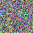

Images at or under 4096 bytes are inlined as `data:` URIs. Larger ones are emitted to `/images/` with a content hash and lazy loading.

A small PNG (294 bytes), inlined as base64:

A small SVG (inlined, URL-encoded rather than base64):

A large PNG (7010 bytes), emitted as a hashed file with `loading="lazy"`:

A remote image passes through untouched:

